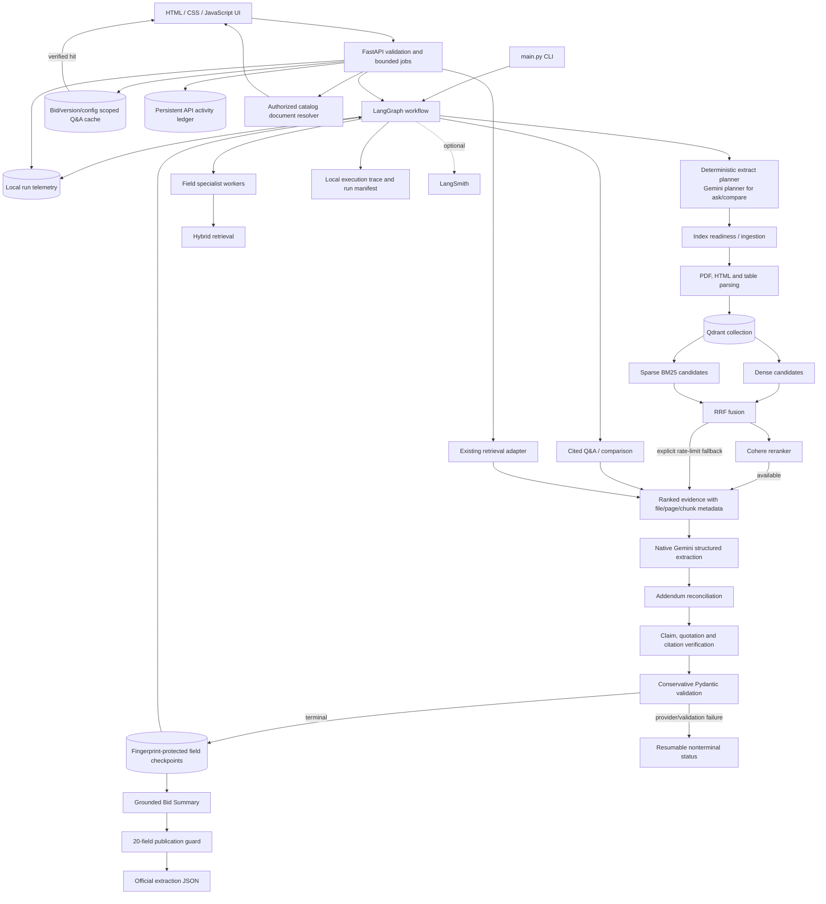

# Architecture

## Execution invariants

1. Retrieval is isolated by bid ID and retains original source metadata.
2. Cohere is the preferred reranker; RRF fallback is disclosed rather than
   represented as successful reranking.
3. An API or transport failure remains a provider/retrieval error, never a
   `not_found_evidence` conclusion.
4. Addendum precedence is applied only when the amendment is explicitly
   supported and verified.
5. Checkpoint reuse requires a matching fingerprint and terminal evidence-based
   status.
6. Publication requires exactly 20 official fields and final Pydantic
   validation; partial runs receive manifests and traces but no official JSON.
7. The HTTP layer accepts catalog identifiers, never arbitrary filesystem
   paths, and caps uploads and background work.
8. Q&A cache reuse requires a matching bid/index/configuration scope, fresh
   citations and unchanged numeric and negation qualifiers.
9. Telemetry never synthesizes missing provider usage or billed cost.
10. Application activity is stored separately from immutable historical
    workflow manifests and traces; neither view deletes or rewrites the other.

## Local API boundary

FastAPI is an adapter over the existing agents. Search calls
`agents.retrieval_agent.search_evidence`; Q&A and extraction call
`workflow.run_workflow`; indexing calls `ensure_bid_indexed`. The frontend does
not duplicate retrieval, extraction, reconciliation or validation behavior.
GitHub Actions compiles the Python packages and runs the offline test suite
without provider credentials or live service calls.
